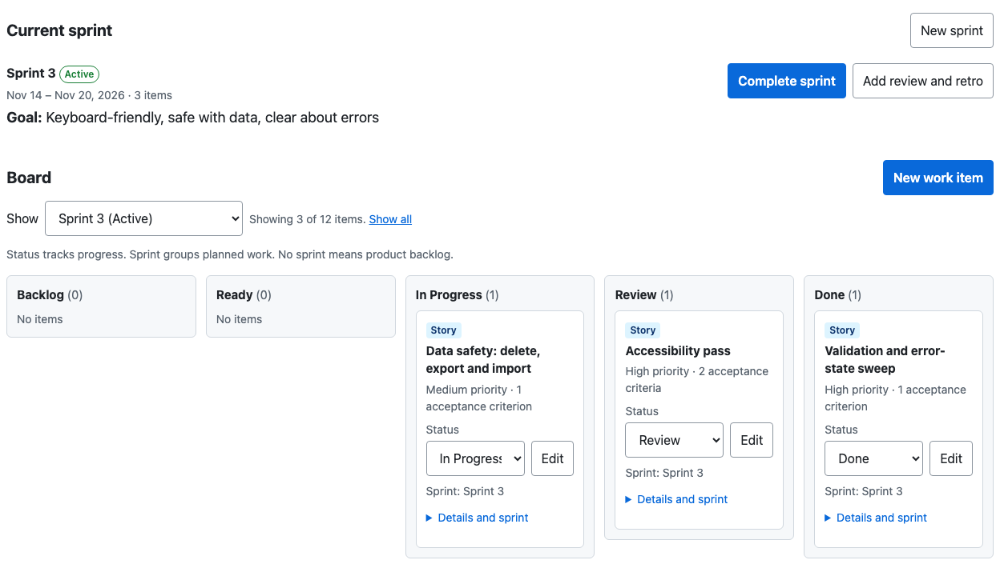
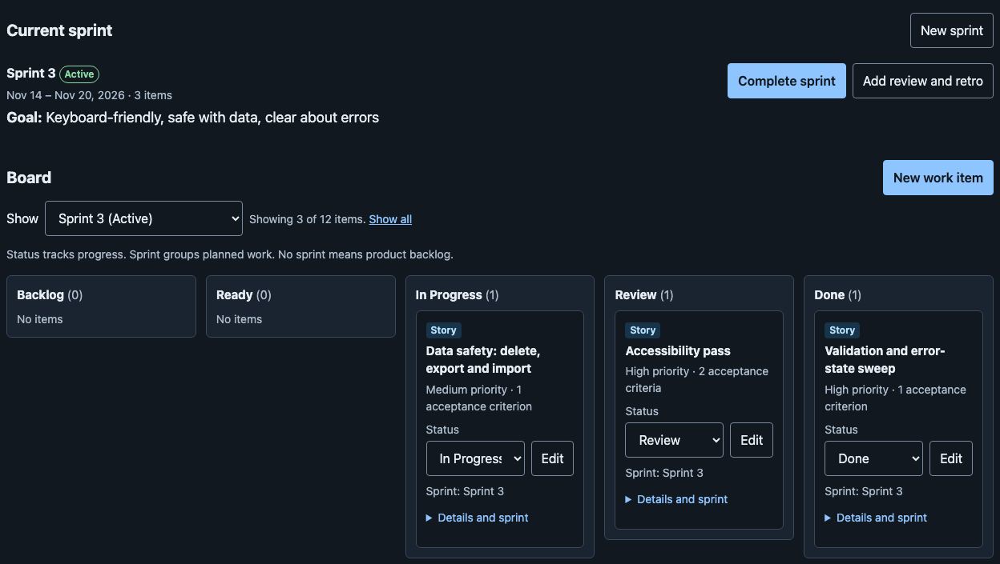

# SprintLab

A focused sprint workspace for solo developers. Plan around a goal, work through a backlog, and close each sprint with a review and retrospective.

[Try the demo](https://kchan1028.github.io/sprintlab/) · [Read the case study](docs/case-study.md) · [Explore the architecture](docs/architecture.md)

Built to explore product and frontend engineering decisions: what to prioritize on screen, how keyboard focus survives state changes, and how a browser-local app protects work when saving fails.



*Screenshots use the built-in demo project; sprint dates are illustrative.*

## Three decisions worth exploring

| Decision | Why it matters | Evidence |
|---|---|---|
| **Current work before history** | The active goal and board lead the page. Completed sprints remain available without crowding the daily workflow. | [Design iteration](docs/case-study.md#put-current-work-before-history), [project composition](src/features/projects/ProjectPage.tsx) |
| **Accessible controls with explicit state** | Status changes use labelled native controls. Sprint assignment is separate from progress, and item details expand without entering an edit form. | [Board implementation](src/features/workItems/Board.tsx), [accessibility checks and limits](ACCESSIBILITY.md) |
| **Recovery is part of the product** | Failed saves retain changes with retry and download. Imports preview replacement before confirmation; completing a sprint moves unfinished work in one save. | [Data-safety decisions](docs/case-study.md#design-for-failure-before-adding-convenience), [storage boundary](src/repository/storage.ts) |

## Try the core workflow

1. Open the [demo](https://kchan1028.github.io/sprintlab/) and choose **add a demo project**. The sample is added beside any existing projects in that browser.
2. Open **SprintLab (demo)**. The active sprint's goal and three assigned items appear first; **Show all** reveals the full project backlog.
3. Expand **Details and sprint** to inspect an item's criteria or assignment. Change its **Status** to move it through the board.
4. Open **Complete sprint** to inspect the carryover decision. **Cancel** leaves the sprint unchanged.

Choose **System**, **Light**, or **Dark** in the header. Project data stays in the browser; JSON export/import provides a manual backup path. The optional AI story drafter is disabled on the public demo.

<details>
<summary>See dark mode and the phone layout</summary>



[Full phone layout](docs/screenshots/mobile.png) · [Phone layout in dark mode](docs/screenshots/mobile-dark.png)

</details>

## Engineering approach

**React + TypeScript + Vite**, with React Router for navigation. Components dispatch actions; pure domain functions own validation and transitions; repository modules own browser storage. The optional drafter uses a serverless function, with its key kept out of browser code.

- **Predictable transitions:** one active sprint per project, valid cross-record assignment, and atomic sprint completion.
- **Explicit view state:** URL filters override the active-sprint default, including an explicit All items choice that survives reloads.
- **Small persistence boundary:** schema and per-record validation, recovery paths, and a separate appearance preference that never changes project backups.
- **Checks at different layers:** 256 unit/component tests, Chromium workflow tests, browser axe checks, and CI. Tests have been deliberately broken to confirm that important regressions are caught.

Read the [architecture](docs/architecture.md), [accepted decisions](docs/decisions/README.md), and [test plan](docs/testing/test-plan.md) for implementation details and verification limits.

## Run locally

Use the Node version in [`.nvmrc`](.nvmrc), currently **24.21.0**. No account or API key is needed for the core app.

```sh
nvm use
npm ci
npm run dev
```

Open the local URL printed by Vite. The empty Projects screen offers **New project** and **add a demo project**.

| Command | Purpose |
|---|---|
| `npm run lint` / `npm run typecheck` | Static checks |
| `npm test` | Domain, storage, component, and axe checks |
| `npm run test:e2e` | Chromium workflows against a production build |
| `npm run build` | Production build in `dist/` |
| `npm run check:docs` | Relative Markdown links and heading anchors |
| `npm run screenshots` | Reproduce the demo screenshots and compact previews |

For the first browser-test run, install Chromium with `npx playwright install chromium`. Optional local drafting and environment configuration are documented in [local setup](docs/runbooks/local-setup.md).

## Status and scope

The latest tagged release is [v1.1.0](https://github.com/kchan1028/sprintlab/releases/tag/v1.1.0). Current `main` also includes the active-work layout and light/dark/system appearance from [PR #50](https://github.com/kchan1028/sprintlab/pull/50). The public demo is built from `main`.

SprintLab serves one developer in one browser. Accounts, team permissions, automatic sync, and team planning metrics are outside its scope. A successful real-key AI draft, screen-reader pass, real-phone check, and non-Chromium runtime coverage remain unverified. Deployment workflow success is recorded separately from live-site testing. See the [roadmap](roadmap.md) and [audit gaps](AUDIT.md).

## Ownership and development

This is an extensively AI-assisted project. The owner selected the audience, stack, hosting, scope, and product constraints, directed implementation, and approved releases. AI tools wrote most of the code, tests, and documentation under the owner’s direction. The [case study](docs/case-study.md#ownership-and-evidence-limits) distinguishes that division of work and its limits; the [collaboration log](docs/ai-collaboration-log.md) preserves decisions and corrections.

The initial learning exercise used four planned sprints, all executed in one session over November 14–15, 2026. That history demonstrates an experiment in solo workflow, not measured weekly capacity or a team delivery record. Author checks, CI, and independent review are separate forms of evidence.

## Documentation

| Looking for | Start here |
|---|---|
| Product problem, decisions, and tradeoffs | [Case study](docs/case-study.md) |
| Requirements and current delivery status | [Product](PRODUCT.md), [roadmap](roadmap.md), [feature overview](feature.md) |
| Structure and implementation navigation | [Architecture](docs/architecture.md), [codebase map](docs/codebase-map.md) |
| Verification and known limits | [Test plan](docs/testing/test-plan.md), [accessibility](ACCESSIBILITY.md), [audit register](AUDIT.md) |
| Development, setup, and reporting | [Contributing](CONTRIBUTING.md), [local setup](docs/runbooks/local-setup.md), [security](SECURITY.md), [code of conduct](CODE_OF_CONDUCT.md) |
| Full document ownership map | [Documentation guide](docs/documentation-guide.md) |

[MIT license](LICENSE).
