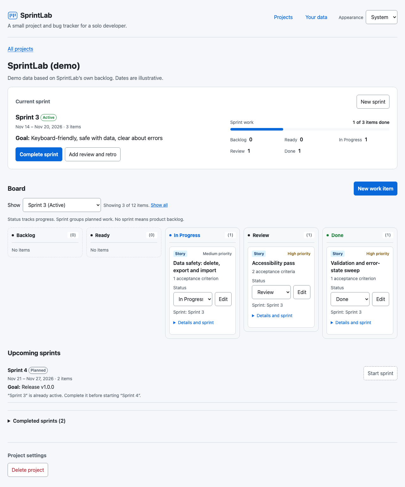
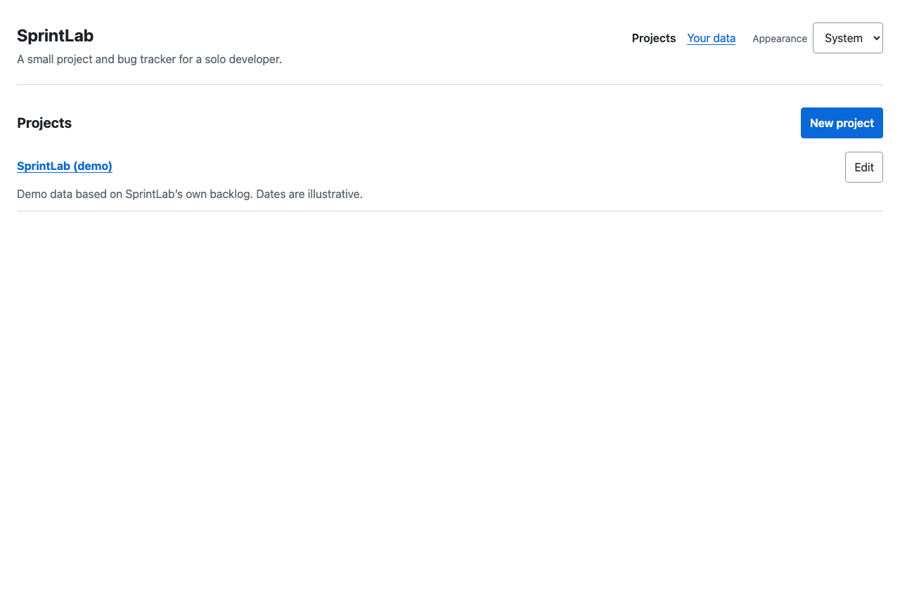
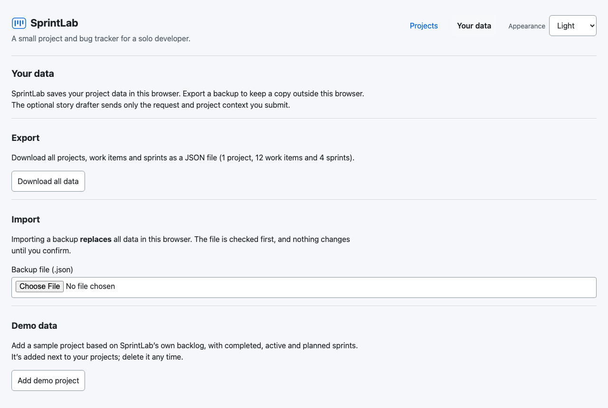
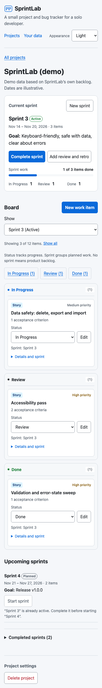

# SprintLab

A small project and bug tracker for one developer: a backlog, a five-column board, short sprints with a goal, and a written review and retro at the end of each one. SprintLab was used to plan its own development, and this repository is the record of how it was built.



**Status:** [v1.0.0 released](https://github.com/kchan1028/sprintlab/releases/tag/v1.0.0) ([notes and known limitations](docs/releases/v1.0.0.md)). Reviews: [Sprint 1](docs/sprints/sprint-1.md), [Sprint 2](docs/sprints/sprint-2.md), [Sprint 3](docs/sprints/sprint-3.md), [Sprint 4](docs/sprints/sprint-4.md).

**Demo:** no hosted demo link in v1.0.0. The app deploys to Cloudflare Pages ([deployment guide](docs/deployment.md)), but the public URL wasn't verified. Run it locally (below) and choose **add a demo project**.

## The problem

Solo developers track side-project work in scattered notes and TODO comments, skip planning, and never look back at what went well. Team tools like Jira are too heavy for one person. SprintLab keeps the useful parts of Agile (a backlog, a board, a sprint goal, a retro) and drops the rest.

**Audience:** one developer with one or more personal projects. No accounts, no team features, no server.

## What it does

- **Projects** with stories and bugs: title, description, priority, acceptance criteria.
- **Board:** Backlog → Ready → In Progress → Review → Done, changed with a labelled control, so no drag-and-drop is needed and it works by keyboard.
- **Sprints:** a required goal, dates, one active sprint per project, assigning work, and filtering the board by sprint (kept in the URL).
- **Completing a sprint:** unfinished work goes back to the product backlog or into the next sprint, in one save. Then record the review and retro.
- **Your data:** export everything as JSON; import a backup (validated, previewed, and applied only after you confirm). Delete a project with a confirmation that shows what will go.
- **Safety:** data stays in your browser (localStorage). Failed saves keep your changes and offer retry and download; damaged data goes to a recovery screen instead of crashing the app.

| Projects | Complete a sprint | Your data | Phone |
|---|---|---|---|
|  |  |  |  |

## Run it locally

Requires Node 22.12+ (`.nvmrc` pins 24.21.0).

```bash
nvm use
npm install
npm run dev
```

Open the printed URL and choose **add a demo project** to explore with sample sprints and work items.

| Command | What it does |
|---|---|
| `npm test` | Vitest: domain, storage, component flows, axe accessibility checks |
| `npm run test:e2e` | Playwright smoke test against the production build (run `npx playwright install chromium` once) |
| `npm run lint` / `npm run typecheck` | oxlint (warnings fail) / TypeScript |
| `npm run build` | Production build to `dist/` |
| `npm run screenshots` | Regenerate the screenshots above |

## How it's built

- **Stack:** React 19, TypeScript 7, Vite 8, React Router 8. The only runtime dependencies are `react`, `react-dom` and `react-router`. Why: [ADR-0001](docs/adr/0001-stack.md).
- **Architecture:** components dispatch actions; rules live in pure functions under `src/domain/`; only `src/repository/` touches storage. Details: [architecture and data model](docs/architecture.md).
- **Quality:** 208 Vitest tests, an end-to-end test in CI, axe checks, and a mutation check in every feature PR. Details: [testing strategy](docs/testing-strategy.md).

## How it was made

- **Process:** four planned one-week sprints, one issue per branch and PR, a Definition of Done in [CONTRIBUTING.md](CONTRIBUTING.md), and a written review and retro after each sprint ([docs/sprints/](docs/sprints/)).
- **AI assistance:** Claude Code wrote most of the code and docs, under the owner's direction and approval. Every PR carries an AI review labelled as such, never presented as a peer review. Decisions, corrections and mistakes (including the AI's) are in the [AI collaboration log](docs/ai-collaboration-log.md). Conventions for the AI: [CLAUDE.md](CLAUDE.md).
- **Honest limits:** all four sprints ran in one AI-assisted session over 2026-11-14 and 15, so they say nothing about real weekly capacity. The VoiceOver check was skipped for v1.0.0, so it's untested with a screen reader. The deployed site isn't verified (checks were local by choice).
- **Case study:** [docs/case-study.md](docs/case-study.md).

## Learning outcomes

_Draft by Claude from the retros, for the owner to edit into their own words:_

- Agile adapted honestly for one person: the SDLC phases happen in every sprint, but there's no pretend team. The product owner, developer and reviewer are the same person, and AI review is labelled as AI.
- Small PRs with acceptance criteria and recorded evidence make progress reviewable and make gaps visible ("not verified" is a valid result).
- Tests are only trusted after they've been shown to fail. Browser checks still found bugs the tests missed in every sprint.
- Accessibility and data safety are cheapest when designed into each feature, not bolted on at the end.

## License

[MIT](LICENSE)
