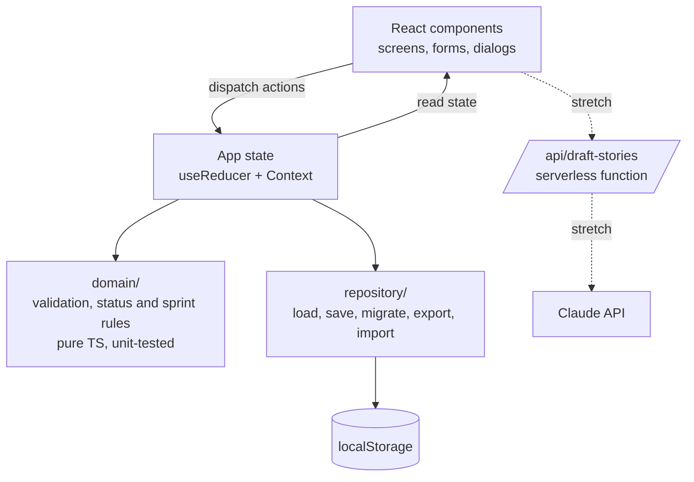
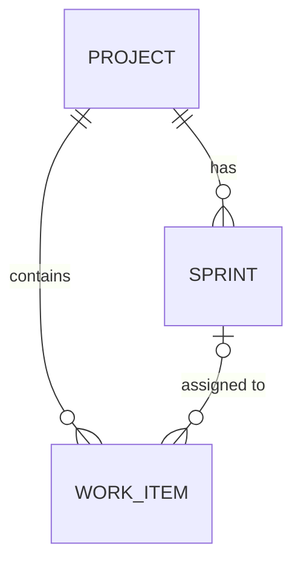

# Architecture and data model

## Overview

SprintLab v1 is a single-page React app with no backend. All data lives in the browser's localStorage. Three rules keep it easy to test and easy to move to a server later:

1. **Components** render state and dispatch actions. They don't touch storage.
2. **Domain functions** (`src/domain/`) hold the rules: validation, allowed status values, one active sprint per project. They are pure TypeScript and unit-tested.
3. **The repository** (`src/repository/`) is the only code that reads or writes localStorage. It handles the schema version, migrations, corrupt data and export/import.



## Data model

```ts
type Status = 'backlog' | 'ready' | 'in_progress' | 'review' | 'done';
type Priority = 'low' | 'medium' | 'high' | 'critical';

interface AppData {
  schemaVersion: number;
  projects: Project[];
  workItems: WorkItem[];
  sprints: Sprint[];
}

interface Project {
  id: string;
  name: string;            // trimmed, 1–80 chars
  description: string;
  createdAt: string;       // ISO 8601
  updatedAt: string;
}

interface WorkItem {
  id: string;
  projectId: string;
  type: 'story' | 'bug';
  title: string;           // required
  description: string;
  priority: Priority;
  acceptanceCriteria: string[];
  status: Status;
  sprintId: string | null; // null = in the backlog
  createdAt: string;
  updatedAt: string;
}

interface Sprint {
  id: string;
  projectId: string;
  name: string;
  goal: string;
  startDate: string;       // YYYY-MM-DD
  endDate: string;         // not before startDate
  state: 'planned' | 'active' | 'completed';
  review: string;
  retro: { wentWell: string; toImprove: string; actions: string };
}
```



### Rules

- A project has at most one `active` sprint.
- Deleting a project deletes its work items and sprints.
- Completing a sprint moves unfinished items back to the backlog (`sprintId: null`) or into the next sprint.
- Data is stored under one localStorage key as a single JSON document. If it fails to parse or validate, the app shows a recoverable error and offers export of the raw data or a reset. It never silently overwrites.
