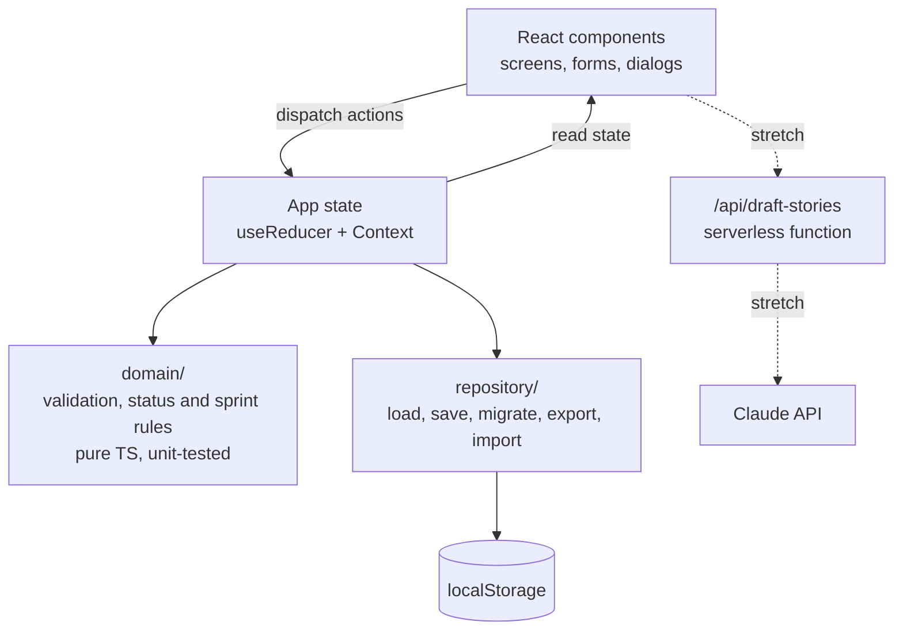
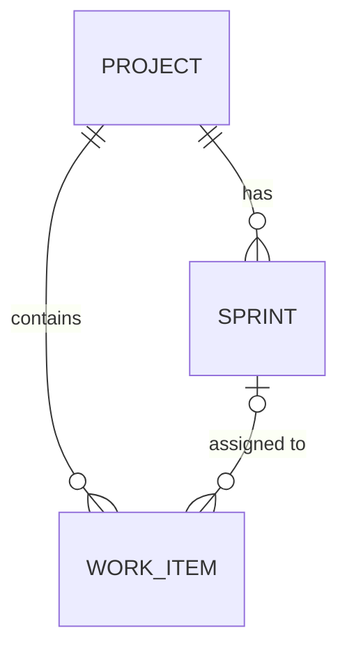

# Architecture and data model

## Overview

SprintLab v1 is a single-page React app with no backend. All data lives in the browser's localStorage. Three rules keep it easy to test and easy to move to a server later:

1. **Components** render state and dispatch actions. They don't touch storage.
2. **Domain functions** (`src/domain/`) hold the rules: validation, allowed status values, one active sprint per project. They are pure TypeScript and unit-tested.
3. **The repository** (`src/repository/`) is the only code that reads or writes localStorage. It handles the schema version, migrations, corrupt data and export/import.



## Routes

React Router 8 in declarative mode (`BrowserRouter` + `Routes`). Cloudflare Pages serves `index.html` for unknown paths, so deep links work after a reload.

| Path | Screen |
|---|---|
| `/` | Projects list |
| `/projects/:projectId` | Project page: sprints (create, start, complete, review and retro, item counts) and the board with five status columns. `?sprint=none` or `?sprint=<id>` filters the board (unknown id → all items; unknown project → "Project not found") |
| `/data` | Your data: export all data as JSON, import a backup (validated, previewed, replaces everything after confirmation) |
| `*` | Page not found |

## Data model

```ts
type Status = 'backlog' | 'ready' | 'in_progress' | 'review' | 'done';
type Priority = 'low' | 'medium' | 'high' | 'critical';

interface AppData {
  schemaVersion: number;
  projects: Project[];
  workItems: WorkItem[];
  sprints: Sprint[];
}

interface Project {
  id: string;
  name: string;            // trimmed, 1–80 chars
  description: string;
  createdAt: string;       // ISO 8601
  updatedAt: string;
}

interface WorkItem {
  id: string;
  projectId: string;
  type: 'story' | 'bug';
  title: string;           // required
  description: string;
  priority: Priority;
  acceptanceCriteria: string[];
  status: Status;
  sprintId: string | null; // null = in the backlog
  createdAt: string;
  updatedAt: string;
}

interface Sprint {
  id: string;
  projectId: string;
  name: string;
  goal: string;
  startDate: string;       // YYYY-MM-DD
  endDate: string;         // not before startDate
  state: 'planned' | 'active' | 'completed';
  review: string;
  retro: { wentWell: string; toImprove: string; actions: string };
}
```



### Rules

- A project has at most one `active` sprint. Sprints are created `planned`; starting one is blocked while another in the same project is active.
- Sprint dates are `YYYY-MM-DD` and the end date can't be before the start. New sprints default to a one-week range starting the day after the latest sprint ends (or today).
- Work items can be assigned only to a `planned` or `active` sprint in the same project. Items already in a `completed` sprint keep showing it, but nothing new can be assigned to it.
- Deleting a project (after an inline confirmation showing what will go) deletes its work items and sprints.
- Import uses the same parser as loading (`parseAppData`) plus cross-record checks (`integrityProblem`: unique ids, references within a project, at most one active sprint). Import **replaces** all data rather than merging, so ids can't collide. Invalid files change nothing.
- Completing an active sprint (one save) keeps Done items in it and moves unfinished items to the product backlog (`sprintId: null`) or to a planned sprint in the same project; items keep their status.
- A completed sprint is read-only except its review and retro, which stay editable.
- Data is stored under one localStorage key as a single JSON document. Loading checks the top-level shape **and every record's fields and types** (`src/repository/validate.ts`). If anything fails, the app shows a recoverable error and offers a download of the raw data or a reset. It never silently overwrites.
- If a save fails (storage full or blocked), changes stay in memory. A banner offers **Try saving again** and **Download a copy**, and the browser asks for confirmation before the tab closes.
- An error boundary around the routes replaces a blank page with a recovery message (reload, download a copy).
