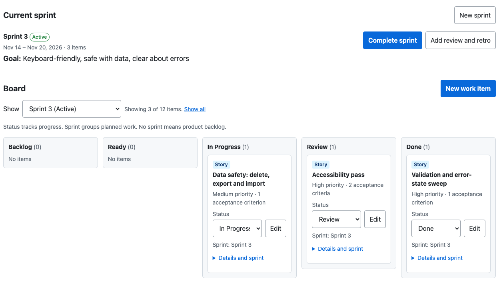
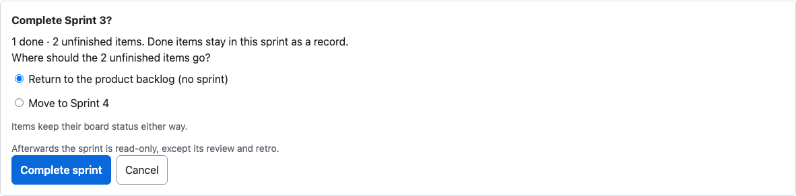
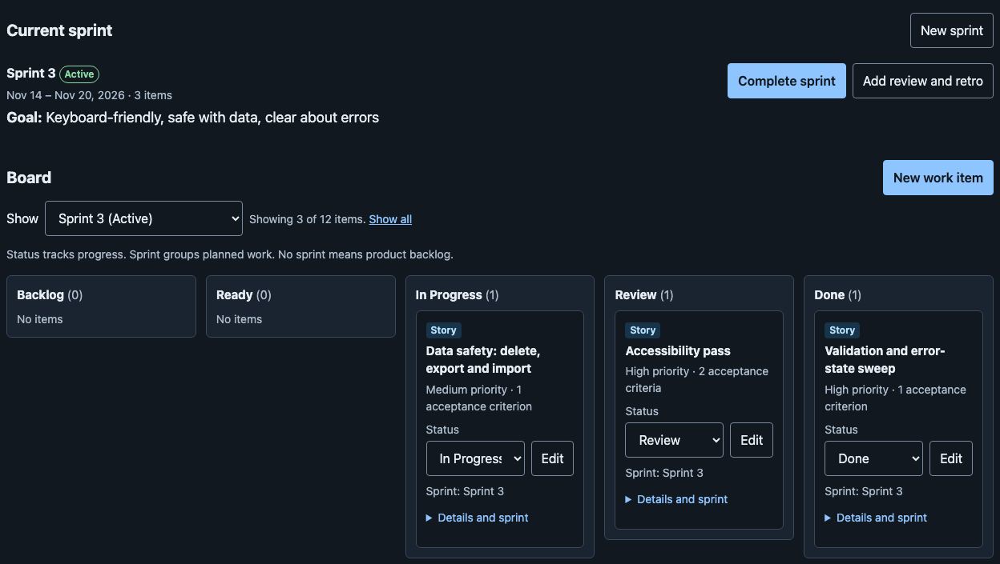

# SprintLab: making the next piece of work easier to see

A product and frontend engineering case study of a browser-local sprint tracker for one developer. The central design problem: retain the useful planning and reflection of Agile while keeping today's work easy to reach.

[Try the demo](https://kchan1028.github.io/sprintlab/) · [View the source](../src/) · [Read the architecture](architecture.md)

**Scope:** product direction, interaction decisions, frontend state, accessibility, persistence, and verification. **Evidence baseline:** repository records through merged [PR #50](https://github.com/kchan1028/sprintlab/pull/50), November 17, 2026. This is an AI-assisted project; [ownership and limits](#ownership-and-evidence-limits) are explicit.

*Screenshots use the built-in demo project; sprint dates are illustrative.*

## The product problem

A solo developer needs to decide what to do next, keep track of bugs, and learn from unfinished work. A collection of notes offers little structure; a team-oriented tracker introduces concepts that may not help one person.

SprintLab explores a narrower proposition: one project backlog, a sprint with a goal, five work states, and a review at the end. The problem definition comes from the project brief. Customer research, adoption measurement, and delivery-speed measurement were outside this exercise.

The core loop is **choose a goal → assign work → change status → complete the sprint → reflect**. The app was also used to plan its own development, giving the repository a concrete record of how the workflow was applied.

## Constraints that shaped the design

| Constraint | Product consequence |
|---|---|
| One developer, personal projects | No accounts, permissions, team administration, velocity, or story points |
| Browser-local storage | No automatic sync; export, import, failed-save recovery, and clear destructive confirmations matter |
| Keyboard access | Native labelled controls for status changes; deliberate focus handling when content moves or forms close |
| Optional model assistance | Drafts remain unsaved until reviewed; the core workflow works without a key or server function |
| Free static hosting for the demo | The public demo uses GitHub Pages and omits the optional drafting endpoint |

[PRODUCT.md](../PRODUCT.md) owns the requirements. The sections below explain the reasoning behind selected decisions.

## Put current work before history

The earlier project page rendered the complete sprint list before the board, including saved reviews and retrospectives. That was coherent as a record of the project, but it gave historical material priority over the daily task. The problem grew as each sprint added more history.

The revised reading order is **active sprint goal → current work → upcoming sprints → completed history**. Completed work is preserved behind a disclosure. The board opens on the active sprint unless the URL explicitly requests another view.

| Earlier presentation | Revised presentation |
|---|---|
| Expanded sprint history before the board | Active goal and board before planning/history |
| All work shown on entry | Current sprint by default; explicit All items remains available |
| Status, assignment, and Edit compete on each card | Status stays direct; assignment, description, and criteria expand when needed |
| Five stacked columns on a phone, including empty ones | Populated-column jump links and omission of empty phone columns |

The implementation lives in [ProjectPage](../src/features/projects/ProjectPage.tsx), [SprintsSection](../src/features/sprints/SprintsSection.tsx), and [WorkItemsSection](../src/features/workItems/WorkItemsSection.tsx). The [earlier screenshot](https://github.com/kchan1028/sprintlab/blob/87e07533ca60467745dbc39813743bf3e133efa4/docs/screenshots/project-board.png) preserves the original layout.

**Tradeoff:** active-first is useful for daily work, but it must not hide an intentional view or newly created items. An explicit `?sprint=all` survives reloads. New items remain unassigned; creation reveals the no-sprint view when the active filter would otherwise hide them.

This iteration followed a design critique and an owner decision. It has local regression coverage; it has not been validated through a user study or measured task-time improvement.

## Keep progress and planning separate

A work item's **status** describes progress: Backlog, Ready, In Progress, Review, or Done. Its **sprint assignment** describes the planned work period. These concepts must remain independent: an unfinished In Progress item can return to the product backlog without pretending that work never started.

The UI makes status directly editable and names sprint assignment separately. Completing a sprint summarizes finished and unfinished work, then asks whether unfinished items should return to the product backlog or move into the next planned sprint. The transition is applied in one save.

**Tradeoff:** a native status select is less visually expressive than dragging cards, but it offers a direct keyboard path and clear labels. That choice supports the product's input model; it does not establish screen-reader conformance. [Board code](../src/features/workItems/Board.tsx) and [completion rules](../src/domain/completion.ts) show the implementation.

## Design for failure before adding convenience

Local storage keeps the core app simple, but it makes the browser the only automatic copy of the user's work. That makes recovery part of the core workflow.

| Failure or risky action | Designed response |
|---|---|
| A save fails | Keep changes in memory; offer retry and download |
| Stored records are damaged or unsupported | Show recovery with the raw-data download where available, instead of repeatedly crashing |
| A backup is invalid | Reject it without changing existing data |
| A valid backup will replace current data | Preview the contents, explain replacement, and wait for confirmation |
| A project is deleted | Name the project and the work that will be removed; offer a backup first |

The [repository](../src/repository/storage.ts) owns persistence. Shared [validation](../src/repository/validate.ts) checks stored records, while [import validation](../src/features/data/importFile.ts) also checks relationships between records.

**Tradeoff:** imports replace rather than merge. Replacement gives the user a clear outcome and avoids ambiguous ID collisions, but the app must explain the consequence before confirmation. There is no undo for confirmed import or deletion.

## Make appearance a preference, not a fork of the interface

System, Light, and Dark use the same hierarchy and semantic color roles across cards, fields, focus, errors, and confirmations. The browser's `color-scheme` also aligns native controls with the selected appearance.

The saved preference is applied before React mounts. It uses a separate repository module and storage key, so it never changes the project schema or backup contents. If the browser cannot remember a choice, it still applies for the current visit and explains the limitation.

[Appearance storage](../src/repository/appearance.ts), [the labelled control](../src/components/AppearanceSelect.tsx), and [design tokens](../src/index.css) expose those boundaries. Local browser tests cover system preference, explicit overrides, reloads, and narrow-screen containment.

## Contain optional AI assistance

The story drafter turns a rough feature request into proposed stories and acceptance criteria. Its design boundary is human review: drafts stay in temporary state until the user edits, discards, or explicitly adds them.

A serverless function keeps the API key outside browser code. Shared validation treats model output as untrusted. The public demo disables the feature; there is no authenticated or rate-limited public drafting service. A successful real-key draft remains unverified.

**Tradeoff:** this adds an optional assisted workflow without making the tracker depend on a model. Keeping it off publicly limits the demo, but avoids exposing an unauthenticated endpoint that could spend credits. The [decision record](adr/0002-ai-drafter.md) covers the alternatives and [server handler](../server/draftStories.ts) contains the boundary checks.

## Engineering and verification

The frontend separates three responsibilities:

| Layer | Responsibility | Example |
|---|---|---|
| Components and state | Render the current view and dispatch user actions | [AppDataProvider](../src/state/AppDataProvider.tsx) |
| Pure domain functions | Validate rules and compute allowed transitions | [Sprint planning](../src/domain/planning.ts), [completion](../src/domain/completion.ts) |
| Repository modules | Load, validate, save, and report persistence failures | [Project storage](../src/repository/storage.ts), [appearance](../src/repository/appearance.ts) |

For the workspace/appearance pass, author verification recorded **256 unit/component tests**, local Chromium workflows, light/dark browser axe checks, long-content checks, and widths from 320px to desktop. A deliberately disabled active-sprint default caused the intended regression test to fail; restoring the implementation returned the suite to green. CI and the GitHub Pages deployment workflow also passed for merge commit `64cc2b7`.

Those checks answer different questions. Unit tests cover transitions; browser tests cover wiring, focus, and rendered behavior; axe catches specific accessibility violations. None establishes full accessibility, independent review, or real-user effectiveness. The [test plan](testing/test-plan.md) and [PR #50 evidence](https://github.com/kchan1028/sprintlab/pull/50) record scope and gaps.

### A follow-up found during review

Starting a planned sprint moves its row above the board. Source review found that this removed the focused Start button without assigning a useful focus destination. [Issue #51](https://github.com/kchan1028/sprintlab/issues/51) tracks a follow-up that focuses the existing start confirmation, backed by a regression that failed on the merged implementation.

That fix is prepared separately and has not been published or deployed. It is evidence that layout transitions need focus assertions, and that passing CI must not be presented as completed code review.

## Ownership and evidence limits

The owner chose the audience, scope, stack, hosting, and constraints; directed implementation; made decisions such as replacement imports, default carryover, and local-only verification; and approved releases. AI tools, initially Claude Code and later Codex, wrote most of the implementation, tests, and documentation under the owner’s direction. The [collaboration log](ai-collaboration-log.md) records the division of work and corrections.

The initial v1.0.0 exercise modeled four planned one-week sprints, executed in one session over November 14–15, 2026. It does not measure weekly capacity or demonstrate a multi-person team's performance. The [sprint retrospectives](sprints/sprint-4.md) remain dated records; later features do not retroactively change those outcomes.

The public demo and optional drafter were added after that initial release. The case study therefore separates current capabilities from historical release claims. Current limits include no screen-reader pass, real-phone or non-Chromium verification, successful real-key draft, or user-study results. Live-site runtime checks remain outside the recorded local verification scope.

PR #50 was merged before independent code review was completed. The owner subsequently clarified the required sequence: code review, resolve blocking findings, pass checks, then merge. Author checks and automated results are not substituted for that missing review.

## What this project demonstrates

- **Product scope:** adapt a planning workflow to one developer rather than reproduce team-tool administration.
- **Interaction judgment:** connect information hierarchy, direct controls, disclosure, and focus behavior to the user's current task.
- **Frontend boundaries:** keep transitions testable and persistence separate from rendering.
- **Trust and evidence:** make recovery and destructive consequences explicit, and distinguish implemented behavior from verified claims.

Next validation priorities are independent code review, assistive-technology checks, real-device and cross-browser coverage, and observation of someone unfamiliar with the app completing the core loop. These are proposed validation steps, not completed research.
